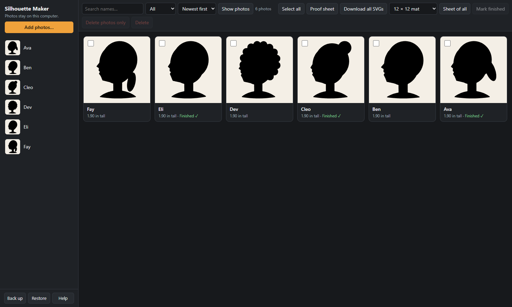
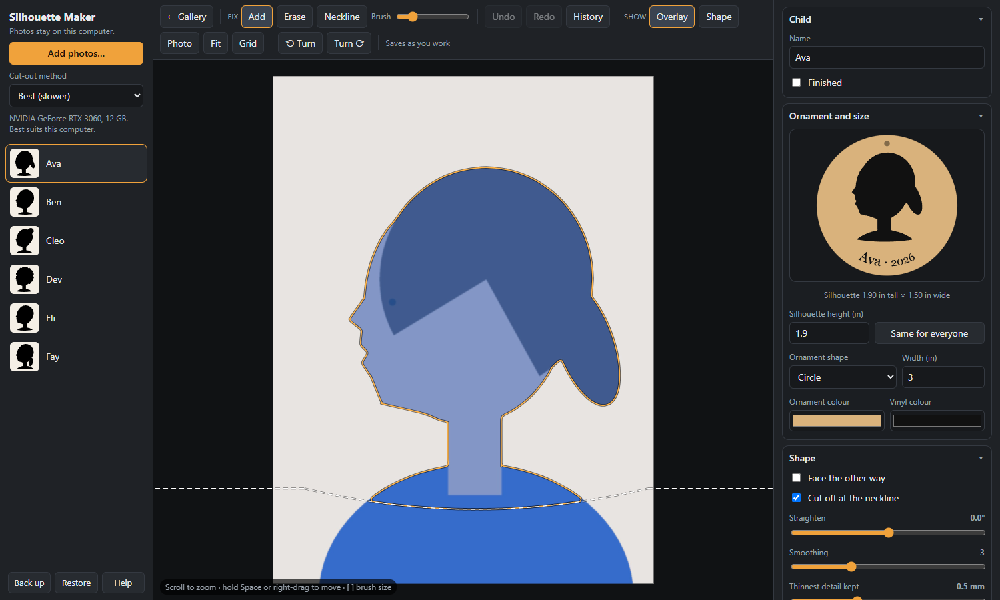

# Silhouette Maker

Turn side-on photos into silhouette cut files for a Cricut, entirely on your
own computer. Made for a daycare ornament project: photograph each child in
profile, cut the silhouette from black vinyl or paper, put it on a wooden
ornament.





*The pictures above use the drawn sample profiles in `samples/`, not real children.*

## Photos never leave the computer

- The cut-out is done by a model running on your PC. Nothing is uploaded.
- The app is a page served from `127.0.0.1` and refuses requests from any other
  computer or web site.
- The only download is the cut-out model itself, fetched once on first use
  (about 170 MB for *Fast*, about 1 GB for *Best*). After that it works offline.
- Working copies of the photos are ordinary files in the `data` folder next to
  the app. **Delete** in the app removes them.

## What it does

- **Automatic cut-out** of each photo, stood upright if it was taken sideways
  or upside down.
- **Touch-up**: Add and Erase brushes with undo and zoom; turn and straighten;
  a grid to line things up.
- **Neckline**: three dots shape the bottom of the bust.
- **Made for cutting**: smoothing, and a "thinnest detail kept" setting in
  millimetres at the finished size, so hair wisps too thin to cut and weed are
  dropped.
- **Sized in inches**, with a preview on an ornament of the size you set.
- **Gallery**: search, mark finished, and download one SVG per child, a zip of
  all, or everyone packed onto mat-sized sheets.
- **Files for Cricut Design Space**: SVG at true size, optional box or ornament
  circle as its own layer, and PNG.

## Install (Windows)

You need Windows 10 or 11 and [Python](https://www.python.org/downloads/) 3.10
to 3.13.

1. Download this repository (**Code → Download ZIP**) and unzip it, or clone it.
2. Double-click **Start Silhouette Maker.bat**. The first run sets itself up
   (a few minutes), then a page opens in your browser.
3. To stop the app, close the black window.

**Best** cut-out quality uses the graphics card (any DirectX 12 card; about
15 seconds a photo on an RTX 3060). If it can't run on your PC, the app says so
and uses **Fast**, which runs on any CPU in about a second and is rougher
around hair.

### Linux and macOS

Not tested. It should run with:

```bash
python3 -m venv .venv
.venv/bin/pip install -r requirements.txt
.venv/bin/python app.py
```

There the *Best* model runs on the CPU and needs roughly 16 GB of free memory;
otherwise the app falls back to *Fast*.

## Use

1. Drop photos on the page or use **Add photos…**. Try the ones in `samples/`
   first. Each is cut out and lands in the **gallery**. Everything saves as you
   work; there is no Save button.
2. Click a card to open it. **← Gallery**, Esc or the browser's Back closes it.
3. Tidy up if needed:
   - **Add / Erase** (B / E) paint the shape in or away. Scroll to zoom, hold
     Space to move.
   - **Undo** (Ctrl+Z) and **Redo** (Ctrl+Y) step through up to 100 changes,
     brush strokes and settings alike. **History** lists every step since you
     opened the photo; click one to go back to it. The list starts fresh each
     time a photo is opened.
   - **Reset to how it started** (in History) puts back the first automatic
     cut-out and the starting settings, at any time, even days later.
   - **⟲ Turn / Turn ⟳** and **Straighten** fix a sideways or tilted photo;
     **Grid** (G) shows lines to straighten against.
   - **Neckline** (N): drag the three dots.
   - **Smoothing** rounds the outline; **Thinnest detail kept** drops what is
     too thin to cut.
   - The orange line is exactly what will be cut.
4. Set **Shape height** and the ornament size, tick **Finished**.
5. **Download SVG for Cricut**. From the gallery, **Download all SVGs** gives a
   zip and **Sheet of all** packs the children onto 11.5 in sheets.

**Around the shape** adds a box or the ornament circle to the files, with
**Space** for a margin. They arrive in Design Space as their own layer: cut
them, use them as a size guide, or delete them. Blank space on its own only
shows in the PNG, because Design Space ignores empty space in an SVG.

### In Cricut Design Space

**Upload → the SVG → add to canvas.** The file is written in the units Design
Space assumes, so it should arrive at the size shown in the app. Check the
first one; if it is off, type the width into the **W** box with the lock on.
On a sheet, each shape carries the child's name in the layers panel.

### Photo tips

- Child looking straight sideways, camera level with the head.
- A plain, bright wall behind, and a little space around the head.
- Hair off the face, so forehead, nose, lips and chin show.
- Neck and shoulders in the frame, so there is room for the neckline.

## For developers

```bash
.venv\Scripts\python -m pip install pytest
.venv\Scripts\python -m pytest -q tests
```

- `engine.py`: cut-out, cleanup, outline and SVG/PNG writing.
- `app.py`: the local server. `--port N` and `--data FOLDER` run a second copy
  for testing without touching real photos.
- `static/`: the page. No build step.
- `tools/make_samples.py` draws the sample profiles.

Please never put a real child's photo in an issue, a pull request or a test.

## Credits

- [rembg](https://github.com/danielgatis/rembg) (MIT) runs the cut-out models.
- [BiRefNet](https://github.com/ZhengPeng7/BiRefNet) (MIT), the *Best* model.
- [U²-Net](https://github.com/xuebinqin/U-2-Net) (Apache 2.0), the *Fast* model.
- [ONNX Runtime](https://onnxruntime.ai/), [OpenCV](https://opencv.org/),
  [scikit-image](https://scikit-image.org/), [Pillow](https://python-pillow.org/),
  [NumPy](https://numpy.org/) and [Flask](https://flask.palletsprojects.com/).

The model files are downloaded from those projects and are under their own
terms. Cricut and Design Space are trademarks of Cricut, Inc.; this project is
not affiliated with Cricut.

## License

[MIT](LICENSE)
